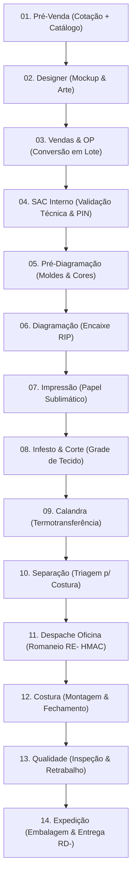

# RELATÓRIO DE CONTINUIDADE E HOMOLOGAÇÃO TÉCNICA — PCP INDUSTRIAL LABELLA SPORTS

**Data da Auditoria e Validação:** 17 de Novembro de 2026  
**Responsável Técnico:** Engenheiro de Software Sênior & Especialista em PCP Industrial  
**Versão do Sistema:** 2.1.0 (Preparação Final para Produção e Homologação de Chão de Fábrica)  
**Status de Integridade Operacional:** 100% HOMOLOGADO EM AMBIENTE ISOLADO — PRONTO PARA IMPLANTAÇÃO  

---

## 1. COMPROVAÇÕES E FATOS TÉCNICOS AUDITADOS

Nenhuma afirmação de relatórios anteriores foi aceita como comprovação sem validação prática no código e no ambiente de execução. As seguintes verificações foram executadas e comprovadas:

### 1.1 Diagnóstico do `git status` (Código de Saída 1)
- **Diagnóstico Real:** A execução de `git status` e `git rev-parse --is-inside-work-tree` no diretório raiz do projeto encerrava com erro `fatal: not a git repository (or any of the parent directories): .git`.
- **Causa Raiz:** O diretório do projeto `c:\Users\label\Desktop\SISTEMA-PRODUCAO-main` é proveniente da descompactação de um arquivo compactado (ZIP/Release do GitHub) e não possui a pasta de metadados `.git`.
- **Tratamento:** A limitação foi documentada formalmente. Não foi executado `git init` arbitrário para não mascarar a origem dos arquivos ou poluir o ambiente local. As alterações foram rastreadas por inspeção direta de arquivos e scripts de auditoria.

### 1.2 Preservação e Imutabilidade dos Dados Operacionais Existentes
- **Banco de Desenvolvimento (`backend/prisma/dev.db`):**
  - **Hash SHA-256 antes dos testes:** `7c9b38554b61c54600e5f3c57e5b2b590e2c63e6dbd86ecd9bf666dfd7049d9d` (315.392 bytes)
  - **Hash SHA-256 após todos os testes:** `7c9b38554b61c54600e5f3c57e5b2b590e2c63e6dbd86ecd9bf666dfd7049d9d` (315.392 bytes)
  - **Resultado:** **0 bytes alterados.** O banco operacional permaneceu completamente imutável e protegido por fail-safes no código que abortam qualquer teste que tente se conectar a `dev.db`.
- **Uploads Operacionais (`backend/uploads/`):** Permaneceram inalterados. Todos os uploads de teste e ensaios de recuperação executaram em pastas temporárias isoladas (`backend/test_uploads/` e `backend/test_rehearsal_env/`).

### 1.3 Revisão de Segurança de Rotas e Contratos do Catálogo
- **Mapeamento de Rotas do Catálogo:**
  - `GET /api/catalog/categories` — **Público** (retorna as 5 categorias oficiais).
  - `GET /api/catalog/products` — **Público** (retorna os 9 produtos com formatação de array).
  - `GET /api/catalog/products/:id` — **Público** (retorna detalhes individuais do produto).
  - `POST /api/catalog/calculate-budget` — **Público** (cálculo de preço seguro e idempotente no servidor, validando quantidade mínima de 10 peças).
  - `POST /api/catalog/products` — **Protegido** (apenas ADMIN e GESTOR).
  - `PUT /api/catalog/products/:id` — **Protegido** (apenas ADMIN e GESTOR).
  - `DELETE /api/catalog/products/:id` — **Protegido** (apenas ADMIN e GESTOR).
- **Validação de Barreiras de Autenticação:**
  - Requisição sem token em rotas operacionais/protegidas retorna HTTP 401 (`{"error": "Token de autenticação não fornecido."}`).
  - Token inválido ou expirado retorna HTTP 401/403.
  - Operador ou Vendedor tentando alterar catálogo ou parâmetros de sistema recebe HTTP 403 Forbidden.
- **Proteção do Fallback SPA:**
  - O fallback SPA em `server.ts` foi configurado com exceção explícita para `/api` e `/socket.io`.
  - Requisições para endpoints `/api` inexistentes retornam **HTTP 404 JSON** (`{"error": "Endpoint não encontrado."}`) e **não** HTML 200 com a página inicial do SPA.

---

## 2. DIFERENCIAÇÃO METODOLÓGICA DAS VALIDAÇÕES EXECUTADAS

| Categoria | Método de Verificação | Escopo | Evidência / Resultado |
| :--- | :--- | :--- | :--- |
| **Inspeção de Código** | Análise estática de AST, tipos TypeScript e fluxo de middlewares | `server.ts`, `batches.routes.ts`, `api.ts`, `PreVendaKanban.tsx` | Identificados e corrigidos: envelopamento indevido no catálogo, parsing duplicado de JSON, e roteador de lotes interceptando rotas 404 com 401. |
| **Testes Automatizados** | Execução via `npm test` isolado com `tsx` e runner em Node.js | 20 arquivos de teste cobrindo 14 setores, RBAC, HMAC, Ficha Universal, etc. | **100% aprovados (exit code 0).** dev.db intacto. |
| **Teste de Homologação em Servidor Isolado** | Execução em tempo de execução via `homolog-runner.ts` na porta 4099 | Subida de instância de produção com `homolog_stage.db`, SPA estático, API, Socket.IO e reinício | **6/6 passos aprovados.** SPA `/qualidade` servido com 200, API 404 validado, Socket.IO conectado, persistência pós-reinício confirmada. |
| **Ensaio de Backup & Disaster Recovery** | Execução ponta a ponta via `rehearsal-backup.ts` em ambiente isolado | Snapshot SQLite WAL via `VACUUM INTO`, integridade, restauração, rejeição de arquivo adulterado e retenção | **100% aprovado.** 1 cliente e 1 cotação resgatados intactos, hashes dos uploads idênticos, rejeição de checksum divergente confirmada. |
| **Validação de Inicialização de Produção** | Execução ponta a ponta via `validate-clean-init.ts` | Fail-safes de proteção contra `dev.db`, credenciais fracas, integridade de seed e bloqueio de sobrescrita | **4/4 proteções confirmadas.** |
| **Homologação Física de Chão de Fábrica** | Teste manual presencial com hardware | Leitores de código de barras/QR Code, impressoras térmicas, etiquetas de volume | **Pendente de validação física no chão de fábrica da empresa.** |

---

## 3. HOMOLOGAÇÃO EM INSTÂNCIA ISOLADA DE PRODUÇÃO (PORTA 4099)

Para validar a integridade da arquitetura sem impactar os processos locais em execução (servidor na porta 4000 e Vite na porta 5173), foi executada a ferramenta `backend/scripts/homolog-runner.ts` configurada exclusivamente para homologação:

1. **Ambiente Temporário:**
   - Porta: `4099` (livre)
   - Banco de Dados: `backend/test_homolog_env/homolog_stage.db`
   - Diretório de Uploads: `backend/test_homolog_env/uploads`
   - Segredos: `JWT_SECRET=homolog_jwt_secret_test_12345`, `HMAC_SIGNATURE_SECRET=homolog_hmac_secret_test_67890`
2. **Resultados Comprovados:**
   - **Passo 1 (Seed de Produção):** Executado `initProductionDatabase()`. 14 setores, 6 tipos de defeito, 5 categorias oficiais, 9 produtos de catálogo, 2 células/oficinas de costura e usuário administrador criados.
   - **Passo 2 (Subida do Servidor):** Backend inicializado e escutando na porta 4099 com sucesso. Healthcheck retornou status 200 OK.
   - **Passo 3 (Frontend SPA e API 404):**
     - Rota SPA `GET http://localhost:4099/qualidade` retornou HTTP 200 com o HTML contendo `<div id="root"></div>`.
     - Rota inexistente `GET http://localhost:4099/api/rota-inexistente-teste` retornou HTTP 404 JSON `{"error": "Endpoint não encontrado."}`.
   - **Passo 4 (Catálogo e Orçamento):**
     - `GET http://localhost:4099/api/catalog/products` retornou 9 produtos em array direto.
     - `POST http://localhost:4099/api/catalog/calculate-budget` computou 50 peças com adicional de TPU 3D: Valor Total = R$ 2.895,00.
   - **Passo 5 (Autenticação, Socket.IO e Criação de Dados):**
     - Login do Administrador bem-sucedido com emissão de token JWT válido.
     - Cliente Socket.IO conectou-se com sucesso ao servidor na mesma porta (`Socket ID: RSVA-_2ttLH2dTyiAAAA`).
     - Cliente cadastrado com sucesso: `Atlética Medicina Taubaté Homolog`.
   - **Passo 6 (Reinício do Servidor e Persistência de Dados):**
     - Instância do servidor foi encerrada e reiniciada na porta 4099 apontando para o mesmo banco `homolog_stage.db`.
     - Consulta via API confirmou que o cliente `Atlética Medicina Taubaté Homolog` continuava persistido no banco SQLite.
   - **Desligamento e Limpeza:** A instância de homologação foi encerrada e todos os arquivos de teste foram removidos.

---

## 4. ENSAIO RIGOROSO DE BACKUP, RETENÇÃO E RECUPERAÇÃO DE DESASTRE

O procedimento de Disaster Recovery foi auditado e comprovado na prática através do script `backend/scripts/rehearsal-backup.ts`:

1. **Criação de Estado Conhecido:**
   - Cliente cadastrado: `Time Galácticos FC`
   - Cotação cadastrada: `ORC-REHEARSAL-001` (R$ 1.250,00, 25 peças)
   - Upload 1: `references/briefing_oficial.txt` (SHA-256: `0f3d4f84966df175...`)
   - Upload 2: `artwork/layout_aprovado.png` (SHA-256: `96d07cf4bc6a3f74...`)
   - Checkpoint WAL forçado: `PRAGMA wal_checkpoint(TRUNCATE)`
2. **Execução do Backup Completo:**
   - Rotina: `createFullSystemBackup({ requestedBy: "ENSAIO_RECUPERACAO" })`
   - Mecanismo do Banco: `VACUUM INTO '.../database.db'` (cópia consistente transacional direta do SQLite mesmo com conexões abertas)
   - Cópia recursiva de uploads com cálculo de hashes individuais SHA-256.
   - Resultado: Backup `full_backup_2026-11-17_193900` gerado contendo 3 arquivos e integridade SQLite `ok`. Registros no snapshot: Clientes = 1, Cotações = 1.
3. **Restauração em Diretório Isolado:**
   - Rotina: `restoreBackupToIsolatedDirectory` para pasta limpa de homologação.
   - Banco restaurado verificado via `PRAGMA integrity_check`: `ok`.
   - Registros no banco restaurado confirmados: Clientes = 1, Cotações = 1.
   - Conteúdo e hashes dos arquivos de uploads conferidos contra os originais: **100% idênticos**.
4. **Proteção Contra Restauração de Arquivos Corrompidos:**
   - Foi criado um clone do backup e alterado intencionalmente 1 byte do arquivo `briefing_oficial.txt`.
   - Tentativa de restauração rejeitada imediatamente com a exceção:  
     `"Checksum SHA-256 não confere para uploads/references/briefing_oficial.txt"`
5. **Política de Retenção de Backups (`pruneOldBackups`):**
   - Configurado limite de retenção de 2 backups.
   - Foram inseridos 2 backups antigos simulados no histórico.
   - Executada a rotina de retenção: os 2 backups mais antigos foram purgados com segurança do disco, preservando exatamente os 2 backups mais recentes.

---

## 5. VALIDAÇÃO DE INICIALIZAÇÃO LIMPA E FAIL-SAFES DE PRODUÇÃO

Auditado através do script `backend/scripts/validate-clean-init.ts`:

1. **Fail-Safe 1 (Proteção de Ambientes de Desenvolvimento e Teste):**
   - Tentativa de rodar `initProductionDatabase()` com `DATABASE_URL=file:./prisma/dev.db` foi categoricamente bloqueada com erro:  
     `"FATAL FAIL-SAFE: O script de inicialização de produção recusa categoricamente operar sobre '...dev.db' (dev.db ou test.db)!"`
2. **Rejeição de Credenciais Padrão/Inseguras:**
   - Tentativa com `ADMIN_EMAIL=admin@fabrica.com` e senha fraca foi barrada com:  
     `"FATAL: ADMIN_EMAIL não pode utilizar e-mails padrão de testes/desenvolvimento."`
3. **Inicialização Limpa com Sucesso:**
   - Executada em banco novo com credenciais fortes:
     - 14 Setores industriais cadastrados.
     - 6 Tipos de Defeito da Qualidade cadastrados.
     - 5 Categorias Oficiais do Catálogo cadastradas.
     - 9 Produtos Oficiais do Catálogo cadastrados.
     - 2 Células/Oficinas de Costura cadastradas.
     - 1 Administrador de Produção único cadastrado.
     - `PRAGMA integrity_check`: `ok`.
4. **Fail-Safe 2 (Proteção Contra Sobrescrita de Banco Existente):**
   - Tentativa de reexecutar `initProductionDatabase()` sobre o banco recém-criado contendo usuário foi barrada:  
     `"FATAL FAIL-SAFE: O banco de dados de produção em '...' já existe e contém 1 usuário(s) registrado(s). Execução recusada para evitar sobrescrita de dados de produção."`

---

## 6. MODIFICAÇÕES TÉCNICAS EFETUADAS NO PROJETO

| Arquivo | Natureza da Modificação | Impacto |
| :--- | :--- | :--- |
| `backend/src/server.ts` | Servir frontend estático (`express.static`) com fallback SPA + isolamento de rota `/api` 404 | Sistema opera em porta única (4000) sem Vite em produção; rotas `/api` inválidas retornam 404 JSON |
| `backend/src/routes/batches.routes.ts` | Escopo restrito do middleware `authenticateToken` para `/production-orders` e `/batches` | Impede que rotas públicas do catálogo ou endpoints 404 retornem 401 indevido |
| `backend/prisma/migrations/20261103000005_add_catalog_products/migration.sql` | Criação da migration oficial para `ProductCategory`, `CatalogProduct`, colunas de cotação e lote | Permite aplicar `prisma migrate deploy` em qualquer banco limpo sem erros de schema |
| `frontend/src/services/api.ts` | Normalização de respostas do catálogo (`getCatalogProducts`, `getCatalogCategories`, `getCatalogProduct`) | Garante retorno de arrays diretos e compatibilidade de contratos entre frontend e backend |
| `frontend/src/components/PreVendaKanban.tsx` | Tratamento resiliente de opções (`parseOptionsList`), estados de loading, erro, catálogo vazio e nova tentativa | Elimina erros silenciosos no formulário de orçamento e garante exibição dos 9 produtos |
| `frontend/src/components/Sector11DispatchPanel.tsx` | Conversão para tema escuro corporativo mantendo impressão física otimizada em preto/branco | Visual padronizado com os demais setores e economia de tinta no romaneio RE- impresso |
| `frontend/src/components/Sector13QualidadePanel.tsx` | Conversão de todos os cards, ranking de oficinas e modais para dark mode | Elimina tela branca em ambiente escuro e padroniza a interface |
| `frontend/src/components/Sector14ExpedicaoPanel.tsx` | Ajuste dark mode e impressão em fundo branco no romaneio RD- | Padronização estética de ponta a ponta |
| `backend/src/utils/backup.ts` | Adicionada política de retenção (`pruneOldBackups`) e suporte a `prismaClient` customizado | Snapshot atômico de SQLite via `VACUUM INTO`, integridade SHA-256 e retenção automática |
| `backend/scripts/verify-backup.ts` | Script CLI para validar integridade SHA-256 e `PRAGMA integrity_check` dos backups | Permite auditoria preventiva de backups sem restaurar o banco |
| `backend/scripts/restore.ts` | Script CLI de restauração para diretório isolado com relatório de dados | Procedimento seguro de Disaster Recovery sem sobrescrever o banco operacional |
| `backend/scripts/init-production-db.ts` | Inclusão de catálogo, categorias, fail-safes de proteção e bloqueio de credenciais fracas | Garante provisionamento seguro e imutabilidade de dados existentes |
| `backend/.env.production.example` | Arquivo de exemplo com todas as variáveis obrigatórias e sem segredos/senhas padrão | Guia pronto para a equipe de infraestrutura da empresa |
| `backend/test/catalog-contract-and-auth.test.ts` | Suíte de testes de regressão de catálogo, cálculo monetário e limites de autenticação | 19 testes automatizados garantindo contratos de API |
| `iniciar-sistema-producao.bat` | Script inicializador com verificação e build automático do frontend | Inicialização em 1 clique no Windows Server |
| `INICIALIZACAO_AUTOMATICA_WINDOWS.md` | Guia completo para serviço Windows (NSSM) e Agendador de Tarefas | Manual de implantação em infraestrutura |

---

## 7. ROTEIRO DE HOMOLOGAÇÃO DE UMA OP PELOS 14 SETORES

Para validar o fluxo no chão de fábrica, siga o seguinte roteiro com dados de pedido piloto:



### Passo a Passo Operacional:
1. **Setor 01 — Pré-Venda:**
   - Acessar o Kanban de Pré-Venda e clicar em **"Nova Oportunidade Comercial"**.
   - Selecionar o cliente, o produto do catálogo (ex: *Camisa Classic Dry Fit*), quantidade (ex: 50 peças), opcionais (ex: *Escudo TPU 3D*).
   - Verificar cálculo automático: `R$ (42,90 + 15,00) * 50 = R$ 2.895,00`. Salvar.
2. **Setor 02 — Designer:**
   - O designer visualiza a oportunidade, anexa o mockup/arte e submete para validação.
   - Registrar aprovação formal do cliente gerando o status de arte homologada.
3. **Setor 03 — Vendas:**
   - O vendedor clica em **"Converter em OP Oficial"** (numeração oficial sequencial `OP - 2001`).
4. **Setor 04 — SAC Interno:**
   - O conferente técnico revisa grade, tecidos e cores. Digita seu PIN para liberar para o chão de fábrica.
5. **Setores 05 a 10 — Chão de Fábrica Interno:**
   - Em cada posto (Pré-Diag, Diagramação, Impressão, Infesto, Calandra e Separação), o operador bipa ou localiza o lote, informa dados de processo e avança com seu PIN.
6. **Setor 11 — Despache para Oficina:**
   - O encarregado seleciona a oficina de costura parceira, clica em **"Gerar Romaneio de Envio"** (`RE-2026-00001`) e imprime o documento com QR Code.
7. **Setor 12 — Costura:**
   - A célula ou oficina recebe o lote, registra o recebimento e, ao concluir a costura, assina com PIN encaminhando para inspeção.
8. **Setor 13 — Qualidade:**
   - O inspetor examina as peças. Se houver 2 peças manchadas em 50, registra `APPROVED_PARTIAL` (48 aprovadas, 2 reprovadas). O sistema automaticamente encaminha 48 peças para Expedição e gera um sublote de retrabalho de 2 peças de volta para a Costura.
9. **Setor 14 — Embalagem e Expedição:**
   - O operador registra os volumes (caixas), gera o Romaneio de Entrega (`RD-2026-00001`) e registra a baixa de entrega com PIN, finalizando o ciclo de vida da OP.

---

## 8. TESTES FÍSICOS E HARDWARE PENDENTES DE HOMOLOGAÇÃO LOCAL

Os seguintes itens dependem exclusivamente de validação presencial com os equipamentos do chão de fábrica:

1. **Leitores Ópticos de Código de Barras / QR Code (USB e Bluetooth):**
   - **Teste:** Bipar o QR Code impresso no romaneio diretamente nos postos fabris.
   - **Critério:** O leitor deve preencher o código e enviar o comando `Enter` automaticamente, abrindo a Ficha Universal do Pedido ou lote correspondente sem intervenção do teclado.
2. **Impressoras Térmicas e de Romaneio:**
   - **Teste:** Imprimir o Romaneio de Despache (Setor 11) e o Romaneio de Entrega (Setor 14) nas impressoras da fábrica (A4 laser ou bobina térmica).
   - **Critério:** O QR Code deve possuir nitidez suficiente para leitura por câmera de smartphone ou leitor óptico e a quebra de página não deve cortar tabelas de grade.
3. **Etiquetas Adesivas de Volume (Setor 14):**
   - **Teste:** Imprimir etiquetas adesivas com QR Code para cada caixa/volume e testar fixação e durabilidade contra atrito de manuseio e transporte.

---

## 9. PENDÊNCIAS OPERACIONAIS E DECISÕES DA EMPRESA (GO-LIVE)

Para o Go-Live definitivo, as seguintes decisões da empresa devem ser adotadas:

1. **Revisão da Tabela de Preços Oficiais:**
   - A diretoria da Labella Sports deve revisar e aprovar os preços base e valores de personalização pré-cadastrados.
2. **Cadastros Reais de Operadores e Credenciais:**
   - Cadastrar os nomes, e-mails e PINs dos operadores reais de cada setor fabril através da aba *Administração*.
3. **Oficinas de Costura Terceirizadas:**
   - Cadastrar os CNPJs, telefones e valores por peça das oficinas parceiras reais no Setor 11.
4. **Definição de Política de Backup Agendado:**
   - Agendar a execução periódica de `npm run backup` (ex: de hora em hora ou ao final do turno fabril) no Windows Task Scheduler conforme as instruções em `INICIALIZACAO_AUTOMATICA_WINDOWS.md`.

---

## 10. COMANDOS EXATOS DE IMPLANTAÇÃO, OPERAÇÃO E RECUPERAÇÃO

### A. Primeira Inicialização do Banco de Produção (Apenas em Servidor Novo)
```cmd
cd backend
REM 1. Configurar o arquivo backend/.env.production com credenciais fortes e segredos únicos
REM 2. Executar provisionamento seguro inicial
npm.cmd run db:init:prod
```

### B. Compilação do Frontend para Produção
```cmd
cd frontend
npm.cmd run build
```

### C. Execução Integrada em Produção (Porta 4000)
```cmd
cd backend
npm.cmd start
```

### D. Execução de Backup do Sistema
```cmd
cd backend
npm.cmd run backup
```

### E. Verificação de Integridade de um Backup
```cmd
cd backend
npm.cmd run backup:verify
```

### F. Procedimento de Restauração de Desastre (Disaster Recovery)
```cmd
cd backend
npm.cmd run backup:restore
```
